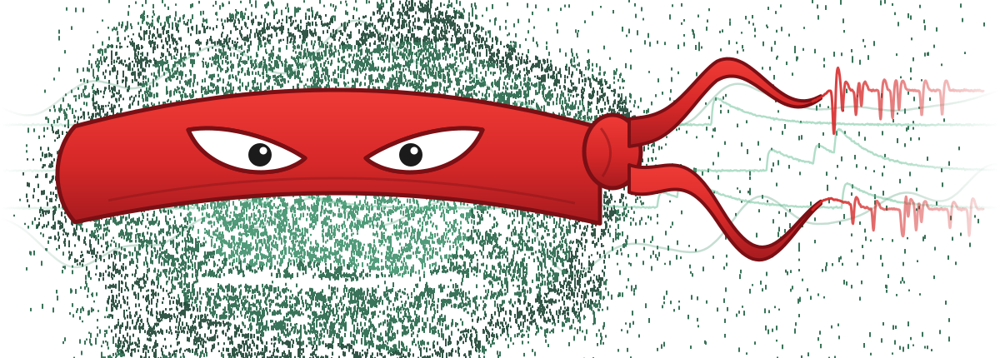

<p align="center">
  
</p>

# Raphael

The shared computational core for neural data analysis in the Mikulovic and
Hangya labs. Raphael turns raw recordings into processed, publishable
per-session files, and provides the analysis tools every project uses on them.

Raphael is a Python package. Each project lives in its own repository,
installs Raphael like any other package, and keeps only its project-specific
code: data conversion, behaviour, analysis and figures.

### → [Getting started](docs/getting_started.md)

Set up VS Code and Claude Code, fork
[starter_project](https://github.com/HDClark94/starter_project), and run
example processing and analysis, step by step.

## What Raphael does

```
   raw Neuropixels / two-photon / fibre photometry
               │
   ┌───────────▼───────────────┐
   │ Raphael                   │  spike sorting (Kilosort 4) · LFP · suite2p · photometry
   │                           │  NWB · population loader · tuning scores
   │                           │  cluster job bundles
   └───────────┬───────────────┘
               │  processed tree, one layout for every project
     ┌─────────┼──────────┐
 starter_project  social-manifolds  ...   project repos
```

| Module | For |
|---|---|
| `raphael.ephys` | Neuropixels → Kilosort 4 → curated units; LFP and theta phase |
| `raphael.imaging` | two-photon → suite2p → ROIs and dF/F |
| `raphael.photometry` | Doric fibre photometry → dF/F per channel (bleaching and isosbestic correction) |
| `raphael.population` | loading spikes or dF/F the same way |
| `raphael.tuning_scores` | spatial information, head direction, speed, with shuffled nulls |
| `raphael.cluster` | job bundles that run anywhere, GPU checks, provenance (`raphael-jobs`) |

**What belongs here:** code that more than one project needs and that doesn't
depend on one project's apparatus or task. Everything else stays in the
project. To move something into Raphael, open a pull request with its tests.

## Documentation

| | |
|---|---|
| [Getting started](docs/getting_started.md) | new laptop to running the examples |
| [Using Raphael from a project](docs/using_raphael.md) | imports, processing stages, project stages, settings, command reference |
| [Neuropixels pipeline](docs/ephys_pipeline.md) · [walkthrough](docs/ephys_walkthrough.md) | spike sorting and LFP, file formats |
| [Imaging pipeline](docs/imaging_pipeline.md) · [walkthrough](docs/imaging_walkthrough.md) | suite2p, file formats |
| [Photometry pipeline](docs/photometry_pipeline.md) | Doric files, dF/F, syncing to video |
| [Running jobs](docs/cluster.md) · [MSC cluster](docs/msc_cluster.md) | job bundles, the MedUni Wien cluster |

## Developing Raphael

```bash
git clone https://github.com/HDClark94/Raphael.git && cd Raphael
uv sync --extra dev                # add --extra gpu to run the Kilosort and suite2p tests
uv run pytest
uv run ruff check src tests
```

The tests simulate recordings with known spikes and ROIs, so they need no lab data.

Several projects depend on Raphael, so change it carefully. A change that
alters outputs (a default threshold, a filter) needs a test and a new version.
To release:

1. Bump `version` in `pyproject.toml` and `src/raphael/__init__.py`, then commit.
2. Tag and push: `git tag v0.2.0 && git push origin main v0.2.0`.
3. Projects move to it with
   `uv add "raphael @ git+https://github.com/HDClark94/Raphael" --tag v0.2.0`.

Python 3.11 exactly: Kilosort 4.0.16, the version in the Methods, needs
numpy < 2 and spikeinterface 0.104.

Split from social-manifolds; conventions follow spatial-manifolds and the
clark2025 dataset, so sessions from all three load with the same code.
