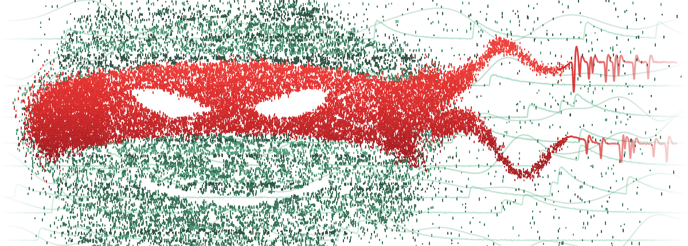

<p align="center">
  
</p>

# Raphael

[](https://github.com/CogEmLab/Raphael/actions/workflows/ci.yml)

The shared computational core for neural data analysis in the Mikulovic and
Hangya labs. Raphael turns raw recordings into processed, publishable
per-session files, and provides the analysis tools every project uses on them.

Raphael is a Python package. Each project lives in its own repository,
installs Raphael like any other package, and keeps only its project-specific
code: data conversion, behaviour, analysis and figures.

### → [Getting started](docs/getting_started.md)

Set up VS Code and Claude Code, create your project from
[starter_project](https://github.com/HDClark94/starter_project), and run
example processing and analysis, step by step.

> **Started a project that uses Raphael? Tell the Raphael owner**, currently
> Harry Clark ([@HDClark94](https://github.com/HDClark94)), so it can be added to
> Raphael's CI. Every change to Raphael is then tested against your project's
> tests before it's released, so you find out about breaking changes before
> they reach you. Send the repository's URL and say whether it's private
> (private repositories need read access for CI). How it works:
> [docs/ci.md](docs/ci.md).

## What Raphael does

```
   raw Neuropixels / two-photon / fibre photometry
               │
   ┌───────────▼───────────────┐
   │ Raphael                   │  spike sorting (Kilosort 4) · LFP · suite2p · photometry
   │                           │  NWB · population loader · tuning scores
   │                           │  cluster job bundles
   └───────────┬───────────────┘
               │  processed tree, one layout for every project
     ┌─────────┼──────────┐
 starter_project  social-manifolds  ...   project repos
```

| Module | For |
|---|---|
| `raphael.ephys` | Neuropixels → Kilosort 4 → curated units; LFP and theta phase |
| `raphael.imaging` | two-photon → suite2p → ROIs and dF/F |
| `raphael.photometry` | Doric fibre photometry → dF/F per channel (bleaching and isosbestic correction) |
| `raphael.population` | loading spikes or dF/F the same way |
| `raphael.sync` | aligning behaviour with recordings from TTL pulses, with sanity checks and a QC figure (preliminary) |
| `raphael.ml` | encoding and decoding with machine learning, from linear regression and GLMs to XGBoost, cross-validated |
| `raphael.toy` | simulated sessions with known tuning, written as raw or processed data |
| `raphael.tuning_scores` | spatial information, head direction, speed, with shuffled nulls |
| `raphael.plots` | rate maps, tuning curves, head direction, theta phase, peri-event, rasters, traces, histograms |
| `raphael.style` | the labs' figure style: Arial, open axes, journal sizes, colours, saving |
| `raphael.cluster` | job bundles that run anywhere, GPU checks, provenance (`raphael-jobs`) |

**What belongs here:** code that more than one project needs and that doesn't
depend on one project's apparatus or task. Everything else stays in the
project. To move something into Raphael, open a pull request with its tests.

## Documentation

| | |
|---|---|
| [Getting started](docs/getting_started.md) | new laptop to running the examples |
| [Using Raphael from a project](docs/using_raphael.md) | imports, processing stages, project stages, settings, command reference |
| [Neuropixels pipeline](docs/ephys_pipeline.md) · [walkthrough](docs/ephys_walkthrough.md) | spike sorting and LFP, file formats |
| [Imaging pipeline](docs/imaging_pipeline.md) · [walkthrough](docs/imaging_walkthrough.md) | suite2p, file formats |
| [Photometry pipeline](docs/photometry_pipeline.md) | Doric files, dF/F, syncing to video |
| [Syncing behaviour](docs/sync.md) | TTL alignment of behaviour with Neuropixels, its checks and QC figure (preliminary) |
| [Machine learning](docs/ml.md) · [notebook](examples/ml_encoding_decoding.ipynb) | encoding and decoding models, how they're scored |
| [Toy data](docs/toy.md) · [dataset notebook](examples/toy_dataset.ipynb) | simulated raw and processed sessions for testing and teaching; a ready three-day dataset |
| [Figure style](docs/style.md) · [Plots](docs/plots.md) | the default look for figures; standard plots and a gallery |
| [Data on Leonardo](docs/data_server.md) | the labs' data server: raw and processed layout, NWB, who can change what (proposal) |
| [Running jobs](docs/cluster.md) · [MSC cluster](docs/msc_cluster.md) | job bundles, the MedUni Wien cluster |
| [Continuous integration](docs/ci.md) | what CI checks, linking a project |
| [Releases, DOIs and publications](docs/releases.md) | versions, releasing, Zenodo DOIs, citing in papers |

## Developing Raphael

```bash
git clone https://github.com/CogEmLab/Raphael.git && cd Raphael
uv sync --extra dev                # add --extra gpu to run the Kilosort and suite2p tests
uv run pytest
uv run ruff check src tests
```

`main` is protected: every change arrives as a pull request, and merges once
CI ("CI passed") is green. Work on a branch, push it, and open a pull request
(`gh pr create --fill`).

The tests simulate recordings with known spikes and ROIs, so they need no lab data.
CI runs them, and every linked project's tests against this Raphael, on each
push and pull request ([docs/ci.md](docs/ci.md)).

When you add a module or a function people should use, add it to
[src/raphael/AGENTS.md](src/raphael/AGENTS.md), the guide coding agents
read (`python -m raphael`); a test checks the guide names only real things
and covers every module.

Several projects depend on Raphael, so change it carefully. A change that
alters outputs (a default threshold, a filter) needs a test and a new version,
and every change that matters to a project gets a line in
[CHANGELOG.md](CHANGELOG.md). To release:

```bash
git switch -c release-0.3.0
uv run python .github/scripts/release_tools.py prepare 0.3.0
git commit -am "Release 0.3.0" && git push -u origin release-0.3.0
gh pr create --fill              # merge once CI passes, then tag main:
git switch main && git pull && git tag -a v0.3.0 -m "v0.3.0" && git push origin v0.3.0
```

See [docs/releases.md](docs/releases.md), including how to cite Raphael and
a project in a paper.

Python 3.11 exactly: Kilosort 4.0.16, the version in the Methods, needs
numpy < 2 and spikeinterface 0.104.

Split from social-manifolds; conventions follow spatial-manifolds and the
clark2025 dataset, so sessions from all three load with the same code.
