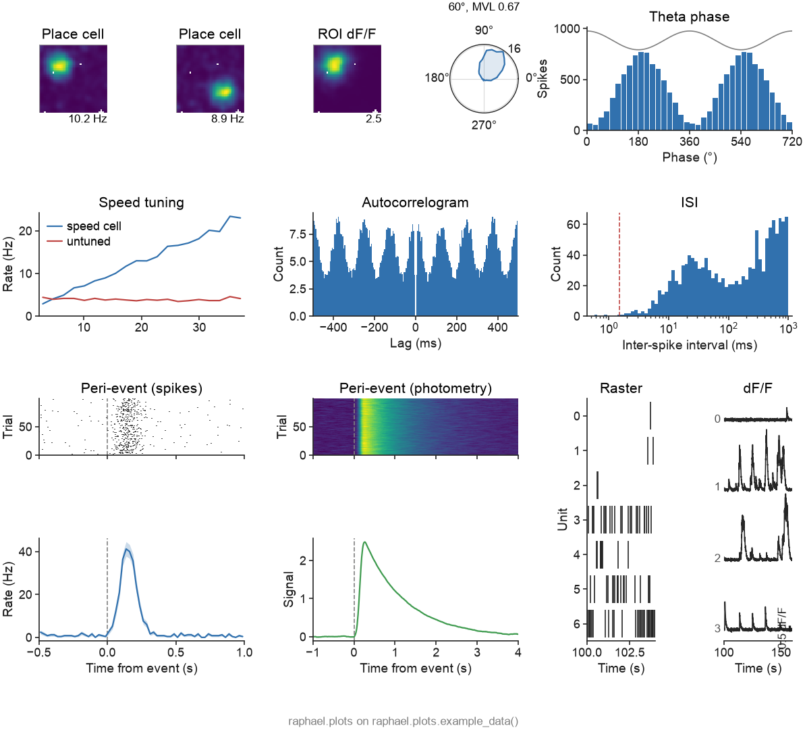

# Plots

`raphael.plots` draws the plots most neuroscience figures are made of, from
processed data, in the [labs' style](style.md). Each function takes the
axes to draw on and returns what it plotted, so a number in the figure and
a number in the text come from the same computation.



```python
import matplotlib.pyplot as plt
from raphael import plots, population, style

style.use()
units = population.load('.../sub-M25_day-18_ses-OF1_srt-kilosort4').accepted()
beh = load_behaviour(...)      # the project's: P_x, P_y (cm), H (rad), S (cm/s), moving

fig = plt.figure(figsize=style.figsize('double', height_mm=50))
plots.rate_map(fig.add_subplot(131), units.data[7], beh, bounds=(0, 100, 0, 100))
_, preferred, mvl = plots.head_direction(fig.add_subplot(132, projection='polar'),
                                         units.data[12], beh)
plots.peth(fig.add_subplot(233), fig.add_subplot(236), units.data[3], events)
```

| Function | Plot | Returns |
|---|---|---|
| `rate_map(ax, activity, beh, bounds)` | rate (or mean dF/F) over the arena, in its real shape (`bounds` in cm); unvisited bins blank; peak rate under the map | the map |
| `tuning_curve(ax, activity, feature)` | rate against any 1-D variable (speed, track position, …); bins visited for under 0.5 s blank | the curve |
| `head_direction(ax_polar, activity, beh)` | polar head-direction tuning, with preferred direction and mean vector length | curve, preferred (rad), MVL |
| `phase_histogram(ax, spikes, phase)` | spike phase (e.g. theta from the `lfp` stage) over two cycles | counts, preferred (rad), MVL |
| `peth(ax_trials, ax_mean, activity, events)` | spikes: raster + mean rate ± SEM; dF/F or photometry: trial heatmap + mean ± SEM | times, mean, SEM |
| `raster(ax, spikes, start, stop)` | population raster | unit order |
| `traces(ax, signals, start, stop)` | stacked dF/F traces with a scale bar | offsets |
| `autocorrelogram(ax, spikes)` | spike autocorrelogram (theta rhythmicity shows as side peaks) | the correlogram |
| `isi_histogram(ax, spikes)` | inter-spike intervals, refractory period marked | counts, edges, violation fraction |
| `score_histogram(ax, scores, null, threshold)` | a score across cells against its shuffled null | fraction above threshold |

`activity` is one unit's spikes (`Ts`, or a one-unit `TsGroup`) or one
continuous signal (`Tsd`: an ROI's dF/F, a photometry channel); the same call
works for both. `raphael.population` objects are accepted where a population
is expected.

## Trying them out

`plots.example_data()` returns a synthetic session with units of known
tuning (place, head-direction, theta-locked, event-responsive, speed and
untuned), behaviour, theta phase, events, imaging dF/F and a photometry
trace. The gallery above is drawn from it
([`docs/assets/make_plots_gallery.py`](assets/make_plots_gallery.py)), and
the tests write it as processed files, load it with `raphael.population`,
and check each plot's numbers against the truth (`tests/test_plots.py`).
