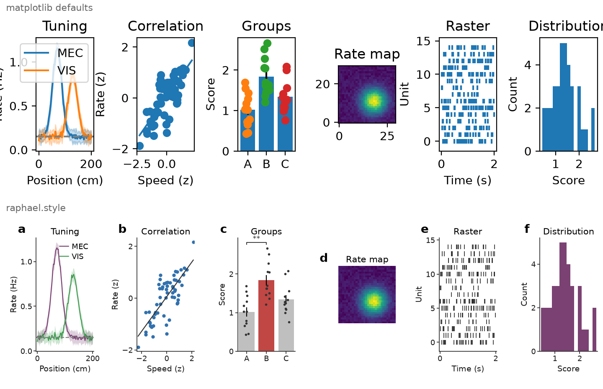

# Figure style

`raphael.style` gives every project's figures the same look, the one the
AnchorDynamics2026 figures settled on. Call it once before plotting:

```python
from raphael import style
style.use()
```

Projects made from starter_project apply it when their package is imported,
so it is the default everywhere. Override anything afterwards:
`style.use({'font.size': 8})` or `plt.rcParams[...] = ...`.



## What the style sets

| | Setting |
|---|---|
| Font | Arial (fallbacks: Helvetica, Liberation Sans, Arimo, DejaVu Sans); maths in the same font |
| Sizes | 7 pt labels, 6.5 pt ticks and legends, 7.5 pt titles, 10 pt bold panel letters |
| Axes | open: no top or right spine; 0.6 pt lines; no grid |
| Ticks | outward, 2 pt long, 1.5 pt from their labels |
| Lines and markers | 0.8 pt lines; markers without outlines |
| Shaded areas | no outline: a `fill_between` band, a bar or a histogram is one colour, without a darker rim |
| Legends | no frame |
| Colours | a default cycle from the labs' figures; viridis for images |
| Saving | 300 dpi, tight bounding box, white background; **fonts embedded as editable TrueType** in PDF and EPS, and as text in SVG, so figures stay editable in Illustrator or Inkscape |

The exact settings are in
[`src/raphael/style/raphael.mplstyle`](../src/raphael/style/raphael.mplstyle).

## Helpers

```python
fig, axes = plt.subplots(1, 3, figsize=style.figsize('double', height_mm=45))
style.mean_with_error(axes[0], x, mean, sem, color=style.REGIONS['MEC'], label='MEC')
style.significance(axes[1], 0, 1, y=2.1, p=0.003)      # bracket with '**'
style.panel_label(axes[0], 'a')
style.tidy(axes[2], left=False)                        # e.g. for a raster
style.scale_bar(axes[2], 1, '1 s')
style.save(fig, 'figures/fig1')                        # fig1.pdf and fig1.png
```

| Function | Does |
|---|---|
| `use(overrides)`, `context()`, `@styled` | apply the style globally, in a `with` block, or inside one function |
| `figsize(width, height_mm=, aspect=)` | inches for a journal column: `'single'` 89 mm, `'onehalf'` 120, `'double'` 183 (Nature); `'cell_single'`, `'cell_double'`, `'elife_double'`, … or a number of mm |
| `panel_label(ax, 'a')` | bold panel letter, top left, outside the axes |
| `tidy(ax, left=, bottom=)`, `bare(ax)`, `offset_spines(ax)` | open axes; remove a side; no axes at all; spines moved off the data |
| `mean_with_error(ax, x, mean, err)` | a line with a same-colour shaded band, no outline |
| `stars(p)`, `significance(ax, x1, x2, y, p)` | `'n.s.'`, `'*'`, `'**'`, `'***'`; a labelled bracket |
| `scale_bar(ax, length, label)` | for traces and images drawn without axes |
| `save(fig, path, formats=('pdf', 'png'))` | every format at once; PDFs carry no timestamp, so re-running a script reproduces the file byte for byte |

## Colours

- `style.REGIONS`: one colour per brain region (MEC, LEC, VIS, SUB, CB, CA1,
  CA3, DG, HPC, PFC), so a region looks the same in every project. Add
  regions in Raphael, not in a project, so everyone shares them.
- `style.GREYS`: `dark`, `mid`, `light`, `faint`, for data that should recede.
- `style.CYCLE`: the default colour cycle.
- `style.CMAPS`: `rate` viridis, `density` magma, `diverging` and
  `correlation` RdBu_r, `phase` twilight (it is circular). Avoid `jet` and
  `hsv`: they invent edges and are unreadable in greyscale and for colour-blind
  readers.

Project-specific colours (cell classes, conditions) belong in the project:
define them once in a module there, not in each figure script.

## Tips

- Histograms are drawn without outlines, so adjacent bins merge into one
  shape; pass `rwidth=0.9` to separate them, or `histtype='step'` for an
  outline (`raphael.plots.score_histogram` does both).
- Build each figure at its printed size (`figsize`) and don't scale it later,
  so 7 pt text prints as 7 pt.
- If Arial is missing (most Linux machines), `use()` warns once and uses a
  metric-compatible stand-in; install Arial before making final figures.
