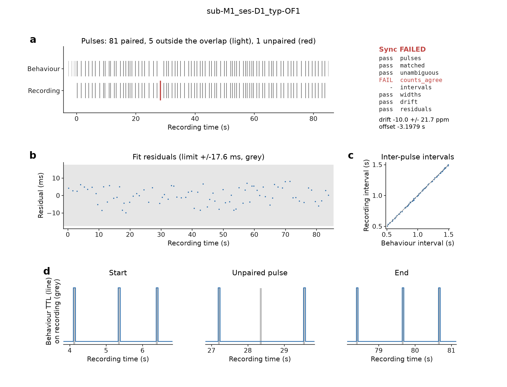

# Syncing behaviour with a recording (preliminary)

Behaviour and neural data are recorded on different clocks. `raphael.sync`
lines them up using TTL pulses that both devices saw. It checks the result
before anything uses it, and draws a figure to check by eye.

**Preliminary.** It handles one TTL column in a behaviour CSV and one TTL
line in a Neuropixels recording made with Open Ephys. Other devices
(SpikeGLX, photometry, cameras) and the `_beh.nwb` file come later. The
checks follow the specification in [data_server.md](data_server.md).

## Run it

```bash
uv run raphael-sync beh.csv "raw/M25/D18/OF1/.../Record Node 101" \
    --out /data/processed --mouse 25 --day 18 --session-type OF1

uv run raphael-sync --simulate /tmp/sync-demo      # try it on a simulated session
```

Or as a job, which also writes the session's provenance record
([cluster.md](cluster.md)):

```bash
uv run raphael-jobs make jobs/M25-D18-OF1-sync --stage sync --cpu \
    --data-root /data --input raw/.../beh.csv --input "raw/.../Record Node 101" \
    --param mouse=25 --param day=18 --param session_type=OF1
```

In Python:

```python
from raphael import sync
beh = sync.read_behaviour('beh.csv')                      # columns: time, ttl, ...
rec = sync.read_openephys('raw/.../Record Node 101')      # TTL line 1 of the probe stream
result = sync.align(sync.edges(beh['time'], beh['ttl']), rec.pulses,
                    behaviour_span=(beh['time'].iloc[0], beh['time'].iloc[-1]),
                    recording_span=(0, rec.duration))
result.passed, result.checks
spike_clock = result.to_recording(beh['time'])
```

## What it expects

- **Behaviour CSV:** one row per sample, with a `time` column (seconds, on
  the rig's clock) and a `ttl` column (0/1, or volts). If yours are named
  differently, use `--time-column` and `--ttl-column`. Other columns are
  carried through.
- **Recording:** an Open Ephys binary-format folder. With Neuropixels PXI,
  the probe's SYNC input is logged as TTL events on line 1 of the probe
  stream. Change the line with `--ttl-line` and the stream with `--stream`.
- **Pulses:** send them at **random intervals** (e.g. 0.5-1.5 s apart).
  Then each pulse can be identified by its intervals, so it doesn't matter
  which device started first. With regular pulses, the two devices must
  both see the first pulse, or the pairing can be off by whole pulses (the
  `unambiguous` check fails if so).

## What it writes

```
{root}/sub-M{mouse}/day-{dd}/ses-{type}/
    sub-..._beh.csv          behaviour rows: `time` on the recording clock (s from
                             its first sample, as spike times), `time_behaviour`
                             the rig's own time, then the CSV's other columns
    qc/sub-..._sync.json     the fit, every check, the settings, the source files
    qc/sub-..._sync.png      the figure below
```

**If a check fails, `_beh.csv` is not written**, and the command exits
with an error (the job is marked FAILED). The report and figure are
still written, so you can see why. Fix the cause, or accept the result
with `--waive "reason"`; the reason is saved in the report.

`_beh.csv` stands in for `_beh.nwb` until that is designed. Rows
recorded while the recording wasn't running are dropped.

## How it works

1. **Pulses**: the rising edges of each TTL trace, and their widths. A
   sampled trace's edge is dated halfway between the last low sample and
   the first high one. Dating it at the first high sample would make every
   pulse half a sample late on average (about 8 ms at 60 Hz).
2. **Pairing**: the two pulse trains are lined up at the lag where the
   most inter-pulse intervals agree. The longest unbroken run of agreeing
   intervals gives a first fit. Every pulse is then paired with its nearest
   partner under that fit, so one missing or extra pulse doesn't break the
   rest.
3. **Fit**: recording time = slope × behaviour time + offset, by least
   squares, refined twice. The slope gives the clock drift, with its
   standard error.

## The checks

| Check | Fails when | Default limit |
|---|---|---|
| `pulses` | either device has too few pulses (wrong channel?) | 10 |
| `matched` | too few pulses pair up | 10 |
| `unambiguous` | pairing every pulse with a partner 1-3 pulses away fits nearly as well (regular pulses) | under half the pairs fit when shifted |
| `counts_agree` | a pulse is unpaired while both devices were recording (dropped, extra or bounced). Pulses sent while one device was off are explained, not failures | 0 |
| `intervals` | an interval is off the expected one (only if `--expected-interval` is set) | ±5% |
| `widths` | a pulse width is unexpected (`--expected-width`), or under half or over twice the median | |
| `drift` | the clocks drift apart more than the limit, by more than 2 standard errors | 50 ppm |
| `residuals` | any matched pulse is further from the fit than the limit | 1 ms + one behaviour sample |

The limits can be set per rig: in Python (`sync.align(..., max_drift_ppm=100)`,
see `sync.DEFAULTS`), on the command line, or in the job's `sync` param.
Cheap clocks (some Arduino boards) can drift by hundreds of ppm. A rig
like that needs a higher limit, or better, a crystal-controlled clock.

## The figure



This example is a simulated session in which the behaviour CSV missed one
pulse.

- **a**: every pulse on the recording clock. Grey ones are paired, light
  ones were sent while the other device wasn't recording, and red ones are
  unpaired (here, the pulse the behaviour CSV missed).
- **b**: fit residuals against the limit (grey band). They should be flat
  noise. A trend means drift the line missed, and an outlier means a pulse
  paired with the wrong partner.
- **c**: each interval between pulses, behaviour against recording. They
  should lie on the diagonal.
- **d**: the behaviour CSV's TTL trace, moved onto the recording clock and
  drawn over the recording's pulses, at the start, middle and end of the
  session (or at an unpaired pulse). After a good sync, the edges coincide
  to within one behaviour sample.
- **Top right**: each check and the verdict.

Rebuild the example with `python docs/assets/make_sync_example.py`.

## Testing without lab data

`raphael.sync.simulate.simulate_session` writes a behaviour CSV and a light
Neuropixels 2.0 recording in Open Ephys format, sharing one pulse train.
The recording has a few channels of noise instead of 384, but the same
folder layout, `structure.oebin`, sample numbers and TTL event files as the
real thing; Raphael's recording reader and spikeinterface both open it. You
choose the clock drift, the offset, regular or random pulses, and dropped
or extra pulses. `tests/test_sync.py` checks that the clocks are recovered
and that each fault is caught.
